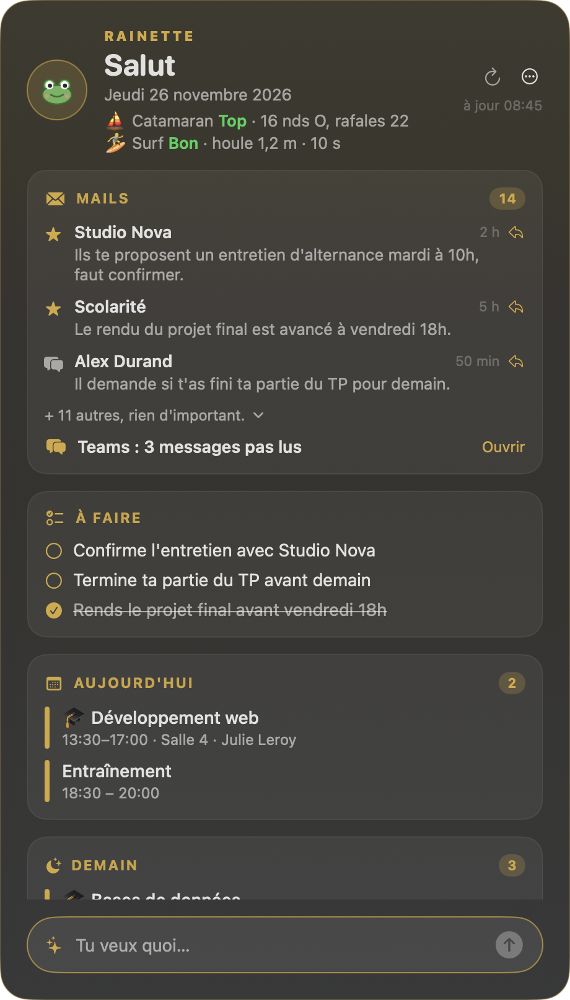
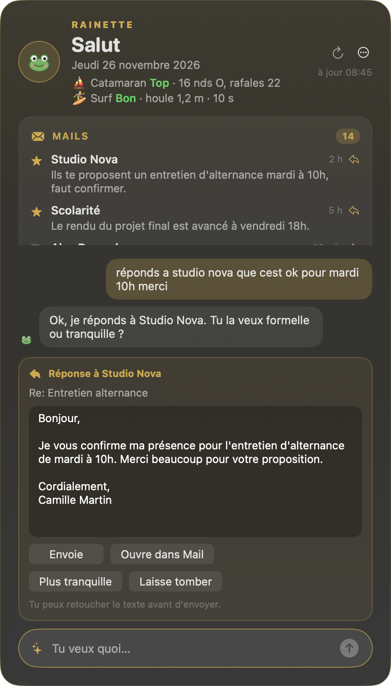
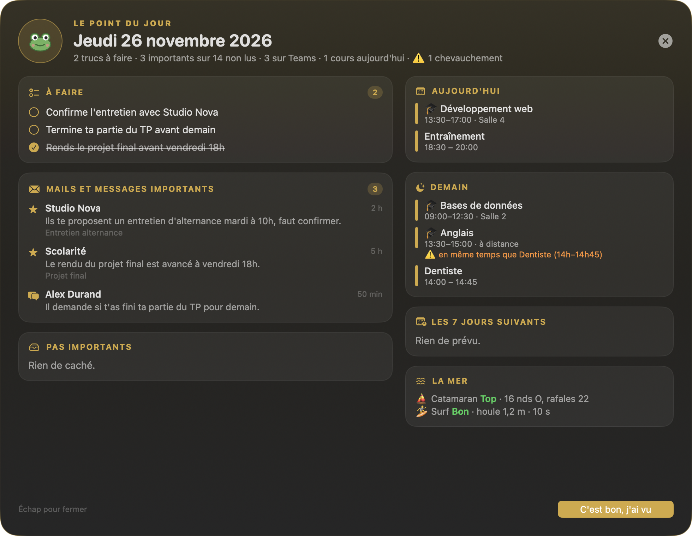

# Rainette 🐸

Rainette, c'est un petit widget que j'ai fait pour mon bureau Mac. Le matin, j'ouvre mon ordi et j'ai tout au même endroit : les mails qui comptent vraiment, ce que j'ai à faire, mes cours du jour et de demain, et si ça vaut le coup d'aller sur l'eau.

<p align="center">
  
  &nbsp;
  
</p>

Je voulais quelque chose qui trie mes mails à ma place sans les envoyer à un service en ligne. Du coup, toute la partie IA tourne en local avec [Ollama](https://ollama.com). Rien ne sort du Mac à part les requêtes vers mes propres comptes et vers la météo.

## Ce qu'elle sait faire

Elle lit mes mails non lus des trois derniers jours et fait le tri pour de vrai : les alertes d'emploi automatiques, les pubs, les newsletters et les notifs de réseaux passent à la trappe, et il ne reste que ce qui compte, résumé en une phrase. Quand un mail demande quelque chose, ça finit dans une petite liste « À faire ». Je coche quand c'est fait, et le mail disparaît du widget (avec un « Annuler » pendant quelques secondes, au cas où). Si jamais elle a caché un mail qui comptait, je déroule la liste de ce qu'elle a mis de côté et je le remonte d'un clic.

Je peux aussi lui parler dans la barre du bas. Je lui demande ce que j'ai demain, je lui dis « mets foot jeudi 18h » et elle me propose l'évènement avant de l'ajouter. Pour répondre à un mail, je lui écris vite fait ce que je veux dire, elle me demande si je la veux formelle ou tranquille, et elle me le remet au propre. Rien ne part tant que je n'ai pas cliqué.

Pour l'école, elle va chercher mon emploi du temps sur la plateforme de l'école (une plateforme Pepal) et mes mails dans Outlook web. Sur Teams, les messages qu'une personne m'envoie directement passent en premier, et les conversations de groupe restent de côté. Elle lit tout ça sans rien marquer comme lu. Et si un rendez-vous tombe en même temps qu'un cours, elle me le signale, y compris au moment où je lui demande de l'ajouter.

Il y a aussi un coin pour la mer : pour un spot de voile et un spot de surf, elle affiche les conditions du moment, avec les données gratuites d'[Open-Meteo](https://open-meteo.com) : « Top », « Pétole », « Trop gros »… avec le meilleur créneau si ce n'est pas le bon moment.

Chaque matin à 7h, une fenêtre s'ouvre au milieu de l'écran avec le point complet : ce qu'il y a à faire, tous les mails importants, ceux qu'elle a mis de côté, les conversations Teams pas lues, les cours et l'agenda des jours qui viennent. Elle reste là tant que je ne l'ai pas fermée moi-même, et un bouton du widget la rouvre quand je veux.

<p align="center">
  
</p>

Et la grenouille n'est pas là que pour la déco : elle cligne des yeux, dort la nuit, sort son parapluie quand il pleut et sourit quand il n'y a plus rien à faire.

Le widget reste collé au bureau, sous les fenêtres. On peut le déplacer et le redimensionner depuis son menu, et il s'aligne tout seul sur les widgets de macOS.

## L'installer

Il faut un Mac Apple Silicon sous macOS 14 ou plus, les outils en ligne de commande d'Apple (`xcode-select --install`, pas besoin de Xcode) et Ollama avec le modèle `qwen3.5:9b` :

```sh
brew install ollama
brew services start ollama
ollama pull qwen3.5:9b
```

Ensuite :

```sh
git clone https://github.com/Fr0gzilla/Rainette.git
cd Rainette
./build.sh
open build/Rainette.app
```

Si la compilation échoue, vérifie le SDK indiqué dans `build.sh` : il doit correspondre à celui que tu as dans `/Library/Developer/CommandLineTools/SDKs/`.

Au premier lancement, macOS demande l'accès au calendrier et l'autorisation de piloter Mail et le Finder (le Finder sert juste à pousser les fichiers du bureau qui se retrouveraient sous le widget).

Petite astuce : sans certificat de signature, macOS peut redemander ces autorisations après chaque compilation. Si tu crées un certificat auto-signé nommé « Rainette (local) » dans ton trousseau, `build.sh` l'utilise et le problème disparaît.

Pour la lancer à l'ouverture de session, le plus simple est un LaunchAgent qui fait `open` sur `build/Rainette.app` avec `RunAtLoad`.

Pour voir à quoi elle ressemble sans rien brancher, lance-la avec des données inventées (c'est ce mode qui a servi pour les images : `--demo-discussion` ajoute un échange, `--demo-point` ouvre le point du jour) :

```sh
build/Rainette.app/Contents/MacOS/Rainette --demo
```

Les règles un peu fragiles (dates, tri, lecture de Teams, chevauchements, mer) ont leurs tests : `./tests.sh`.

## La régler

Tout ce qui est perso (nom, adresses, contacts, école, spots) se met dans un fichier à part, qui reste sur ton Mac :

```
~/Library/Application Support/Rainette/reglages.json
```

Le plus simple est de partir de [`reglages.exemple.json`](reglages.exemple.json) et de remplacer les valeurs. Tu n'es pas obligé de tout remplir : ce qui n'est pas réglé n'apparaît pas.

- `prenom` et `nomComplet` servent à signer tes réponses, et `profil` aide l'IA à savoir ce qui est important pour toi.
- `comptesMail` liste les comptes de l'app Mail à lire (vide = tous).
- `compteMicrosoft` active Outlook, Teams et la connexion à l'emploi du temps. `contactsTeams` dit de qui lire les messages.
- `emploiDuTemps` prend l'adresse de la page d'emploi du temps.
- `mer` prend deux spots, chacun avec un point pour le vent (près de la plage) et un pour la houle (un peu au large).
- `meteo` est le point `[latitude, longitude]` où regarder s'il pleut, pour que la grenouille sorte son parapluie (par défaut, le spot de voile).

Pour Outlook, Teams et l'emploi du temps, un bouton « Brancher » apparaît dans le widget : tu te connectes une fois et c'est bon. Rainette n'ouvre ensuite ces pages que le temps de les lire, pour ne pas manger de mémoire.

Si quelque chose ne s'affiche pas, `~/Library/Application Support/Rainette/journal.txt` dit ce qu'elle a trouvé à chaque lecture.

## Les limites

Outlook, Teams et l'emploi du temps sont lus directement dans leurs pages web, donc si Microsoft ou la plateforme de l'école changent leur interface, il faudra adapter la lecture. Pour Teams, elle lit les conversations, mais pas les publications dans les équipes ni les mentions. Et tout est en français, l'interface comme les réponses de l'IA.

## Licence

[MIT](LICENSE) © 2026 Fr0gzilla
